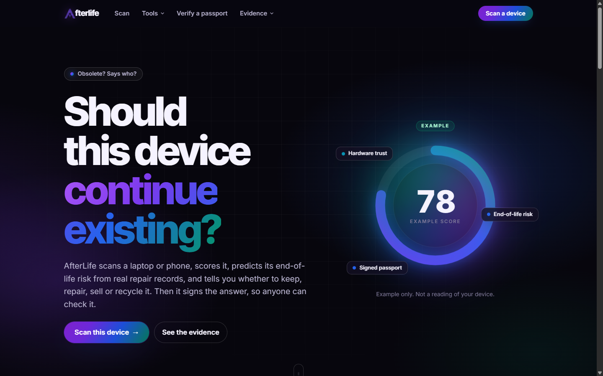
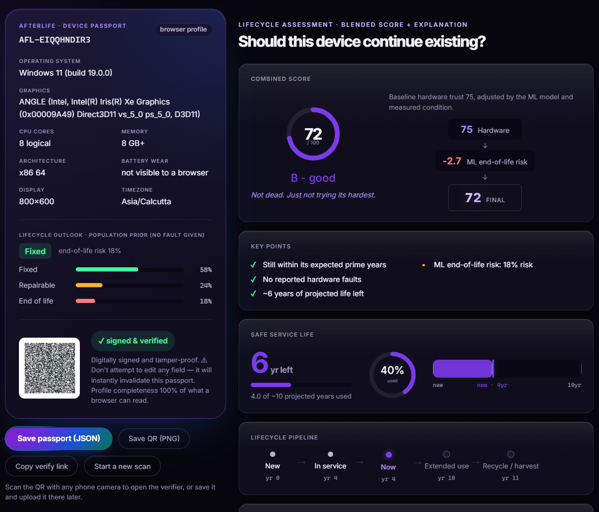

# AfterLife — Device Lifecycle Intelligence

**Should this device continue existing?**

AfterLife scans a laptop or phone in the browser, checks it against real repair,
security and carbon data, and gives a **keep / repair / sell / recycle** verdict
with the evidence behind it. The result is sealed into a **digitally signed
passport** with a QR code that anyone can verify later.

**Live:** https://afterlife-ruhin.vercel.app

> Every number on screen is computed from data. Nothing is typed in by hand, and
> the written summary only explains the numbers. It can never change them.



---

## The problem

Millions of working devices are thrown away because nobody can tell whether
they are still worth keeping. "Your operating system is out of support" is
often treated as a reason to replace a machine, even though most of a laptop's
lifetime carbon is spent *making* it, and most serious security flaws need an
attacker who is already on the device.

AfterLife gives people a verdict they can check instead of a guess.

## SDG alignment

| Goal | Target | How AfterLife contributes |
|---|---|---|
| **SDG 12** Responsible Consumption and Production (primary) | 12.5: reduce waste through prevention, repair and reuse | Makes keep or repair the informed default, so fewer working devices are discarded early |
| **SDG 13** Climate Action (primary) | 13.3: awareness of climate change mitigation | Shows the carbon cost of a replacement at the moment the keep-or-replace decision is made |
| **SDG 9** Industry, Innovation and Infrastructure | 9.4: resource-use efficiency | Data-driven tooling for a circular approach to devices |
| **SDG 11** Sustainable Cities and Communities | 11.6: reduce municipal waste | Less e-waste entering the urban waste stream |

---

## What it does

Sprint 1 built the core; Sprint 2 made it a complete decision tool.

| Feature | What the user sees | Sprint |
|---|---|---|
| **Instant scan** | After a consent screen, the browser reads the OS, graphics, CPU cores, memory, architecture, display and timezone. The user adds age, use and any fault in their own words. No download. | 1 |
| **Deep scan** | A small read-only script (Windows `.bat` + PowerShell, or a shell script on macOS/Linux) reads battery wear, drive health, TPM and Secure Boot, the real processor, 90 days of error-log counts and 11 security settings. The `.bat` checks the script's SHA-256 fingerprint before running it. It sends counts, never names. | 2 |
| **Lifecycle assessment** | A score out of 100, a grade and a waterfall showing every point; a deep scan gives a *measured* score from four shown sub-scores | 1, 2 |
| **ML end-of-life risk** | A calibrated model trained on 23,748 real repair outcomes; the risk % leads | 1, 2 |
| **Remaining service life and pathways** | Estimated safe years; keep, harden, repurpose, sell or recycle, ranked; the page leads with why the visitor came (sell, keep or safety) | 1, 2 |
| **Usage fit** | Is the device up to the owner's work (general, gaming, coding, editing), now and in a few years | 2 |
| **Repair outlook and repair rights** | What fixing it buys (re-scored as if repaired), how often similar repairs succeeded, and which repair laws apply in the owner's country | 2 |
| **EU repairability grade** | The official A–E grade from the EU's EPREL register for phones and tablets | 2 |
| **Resale estimate and sell checklist** | A price range with the formula shown, and the steps to sell safely, including a wipe check | 2 |
| **Carbon trade-off** | Payback years of a replacement for light, typical and heavy use, on the owner's grid, using the processor's power class | 1, 2 |
| **In plain words** | A language model words the result; every number and date it writes is checked against the computed facts, or the rule-based summary is shown | 2 |
| **Plain / technical view** | One switch shows the results simply or with *The working* for every calculation | 2 |
| **Signed passport, QR and PDF** | Ed25519-signed W3C Verifiable Credential; JSON, QR image or printable PDF | 1, 2 |
| **Verifier and Compare** | Check a passport by upload, paste or camera; compare verified passports side by side | 1, 2 |
| **Accounts and My Scans** | Optional sign-in (Supabase); only genuine passports can be saved | 2 |
| **Security report** | Known Windows flaws matched to every setting that blocks them, and which ones this PC already has | 2 |
| **Evidence pages** | *How it works* (with all 57 assumed numbers and their reasons), *The Argument*, *Our Research* (with a sensitivity analysis), *Data Sources* | 1, 2 |
| **Tools** | Carbon calculator for any country, Windows 10 support countdown, Secure Boot certificate deadlines | 1, 2 |



## How it works

```
  Browser (React + Vite, on Vercel)              Backend (FastAPI, Python 3.12, Docker on Render)
  ─────────────────────────────────              ────────────────────────────────────────────────
  Instant scan  browser facts + owner's answers ─► /api/scan-passport     model risk, signed passport
  Deep scan     script posts to a one-time link ─► /api/deep-scan/{token} measured, signed passport
  Results       signed facts                    ─► /api/assess            score, years, pathways, carbon,
                                                                           usage fit, repair, rights, resale
                                                ─► /api/explain           plain words (Groq), numbers checked
  Verify, Compare  passport JSON or QR          ─► /api/verify            Ed25519 signature and issuer
  Accounts      Supabase sign-in in the browser ─► /api/save-scan  /api/my-scans
  Evidence, tools                               ─► /api/findings  /api/thesis  /api/sources  /api/assumptions
                                                   /api/sensitivity  /api/carbon-calc  /api/esu ...
        all read precomputed files in app_data/ and models/, built offline by scripts/
```

Every outside service is optional and has a fallback: without Groq the
rule-based summary is shown; without Supabase the site works without accounts;
without Redis, one-time deep-scan links are held in memory.

### The machine-learning model

- **Data:** Open Repair Alliance repair events, filtered to five IT product
  categories with a known outcome: **23,748 records** from **8** repair
  organisations. Each record is labelled by a technician as *Fixed*,
  *Repairable* or *End of life*.
- **Models compared:** Logistic Regression, Random Forest and XGBoost
  (`scripts/train_lifecycle.py`).
- **Honest evaluation:** whole repair organisations are held out in each fold
  (4-fold grouped validation), so the model is scored on venues it never saw.
- **Selection:** on **End-of-life recall**, not accuracy. A majority-class
  baseline scores well on accuracy while catching zero end-of-life devices,
  which is exactly the failure this product exists to prevent.
- **Calibration:** the risk is calibrated so it behaves like a real probability
  (calibration error **0.025**), because it is subtracted from the device's score.

### Why the passport can be trusted

The passport is signed with an **Ed25519** private key that only the server
holds. Changing even one character breaks the signature. The verifier also
checks *which* key signed it. A forger could sign a fake passport with their
own key, so a valid signature alone is never reported as "issued by AfterLife".

---

## Technologies used

| Layer | Technology |
|---|---|
| Website | React 18, Vite, plain CSS (responsive, with a mobile menu) |
| Server | Python 3.12, FastAPI, Pydantic, Uvicorn |
| Machine learning | scikit-learn (calibrated random forest, TF-IDF text features), pandas, joblib |
| Passport | Ed25519 signatures (`cryptography`), W3C Verifiable Credential envelope, QR codes (`qrcode`, `jsQR`, `pako`) |
| Plain-words summary | Groq API (`openai/gpt-oss-20b`), with every number checked in code |
| Accounts | Supabase (Auth + PostgreSQL with row-level security) |
| Deep scan | PowerShell (Windows) and shell (macOS/Linux) read-only collectors |
| Testing and CI | pytest, Vitest, GitHub Actions |
| Hosting | Vercel (website), Render (Docker container for the API) |

## Getting started

The site is live at https://afterlife-ruhin.vercel.app (frontend on Vercel, API in
Docker on Render). More detail on running it locally and on a phone is in
**[docs/SPRINT1_GUIDE.md](docs/SPRINT1_GUIDE.md)**; the order for rebuilding the
data is in **[docs/DATA_PIPELINE.md](docs/DATA_PIPELINE.md)**.

Windows, two Command Prompt windows (Python 3.12 and Node 22):

```bat
:: one-time setup
py -3.12 -m venv venv
venv\Scripts\python -m pip install -r requirements.txt
cd frontend && npm install && cd ..

:: terminal 1: backend on http://localhost:8000
set PYTHONPATH=.
venv\Scripts\python -m uvicorn api.main:app --port 8000

:: terminal 2: frontend on http://localhost:5173
cd frontend
npm run dev
```

API documentation is generated automatically at http://localhost:8000/docs.
A local server makes its own signing key in `data/keys/` on first start, so
passports made locally verify as "Issued by AfterLife" only on that server.

### Optional settings

Everything runs without these. Put them in a `.env` file in the project root
(git-ignored) or, on a server, in environment variables. Never commit them.

| Setting | Turns on |
|---|---|
| `GROQ_API_KEY` (optionally `GROQ_MODEL`) | The *In plain words* card |
| `SUPABASE_URL`, `SUPABASE_SERVICE_ROLE_KEY` | Saving scans on the server |
| `VITE_SUPABASE_URL`, `VITE_SUPABASE_PUBLISHABLE_KEY` (in `frontend/.env.local`) | Sign-in in the browser |
| `VITE_API_BASE` | Where the frontend finds the API when they are on different domains |
| `AFTERLIFE_PRIVATE_KEY_B64` | A fixed signing key on a server (otherwise one is generated) |
| `CORS_ORIGINS`, `REDIS_URL` | Extra allowed origins; a shared store for deep-scan links |

## Running the tests

```bat
set PYTHONPATH=.
venv\Scripts\python -m pytest          :: backend: 553 tests

cd frontend
npm test                               :: frontend: 63 tests
```

The backend tests drive the real API through FastAPI's test client. They check
that the figures on the research pages match the data on disk, that a tampered
passport fails verification, that a missing measurement is never reported as a
healthy one, that the language model's text is rejected when a number does not
match, and that every assumed number has a reason. Outside services (Groq,
Supabase) are replaced by fakes. GitHub Actions runs both suites and a
production build on every push.

## Sample outputs

[docs/sample_outputs/](docs/sample_outputs/) holds real outputs of the API for
one example laptop (6 years old, "battery drains fast"), made by
`scripts/make_sample_outputs.py` with no network calls:

| File | What it shows |
|---|---|
| `1_browser_scan_input.json` | What the browser reports, plus the owner's answers |
| `2_signed_passport.json` | The signed passport, including the model's end-of-life risk |
| `3_assessment.json` | The full assessment: score and every adjustment, years left, pathways, carbon payback, usage fit, repair outlook, repair rights |
| `4_verify_genuine_and_tampered.json` | The verifier's answer for the genuine passport, and after one value is edited |

The passport is signed with the local machine's key, so it verifies as
"issued by AfterLife" only on the server that made it. Screenshots of the
running site are in [docs/screenshots/](docs/screenshots/).

---

## Project structure

```
afterlife/      core library, one module per concern (36 modules), for example:
  assessment.py       score, grade, remaining years, key points (named rule constants)
  pathways.py         the lifecycle pathways
  predict.py          loads the trained model and predicts
  passport.py         builds, signs and verifies passports; the deep-scan trust score
  grid.py             carbon payback on a country's grid (break_even, payback_range)
  persona.py          usage fit;  uplift.py  repair outlook re-scoring
  repair_evidence.py  repair success rates;  repair_rights.py  repair laws
  eprel.py            EU repairability grade;  pricing.py  resale estimate
  explain.py, llm.py  plain words and the number check
  assumptions.py      the assumptions table;  sensitivity.py  sensitivity analysis
  hardening.py, mitigation.py  security report;  win11.py, secure_boot.py, esu.py
  auth.py, kvstore.py accounts and the one-time deep-scan store
api/main.py     FastAPI backend: validates input and routes the requests
collector/      the read-only deep-scan scripts (PowerShell and shell)
frontend/       React + Vite website (src/v2/ holds the site shell and the newer pages)
scripts/        data pipeline and model training (produce app_data/ and models/)
app_data/       computed data files the API reads
models/         trained model and metrics
tests/          backend tests (frontend tests sit next to the code as *.test.js)
docs/           guides and screenshots
```

## Data sources

| Source | Used for | Licence |
|---|---|---|
| [Open Repair Alliance](https://openrepair.org/open-data/) | Training the model; repair success rates | CC BY-SA 4.0 |
| [National Vulnerability Database](https://nvd.nist.gov/) | Windows 10/11 CVE corpus | Public domain |
| [CISA KEV](https://www.cisa.gov/known-exploited-vulnerabilities-catalog) | Which flaws were really exploited | Public domain |
| [FIRST EPSS](https://www.first.org/epss/) | Exploit probability per CVE | Free for any use, attribution requested |
| [Boavizta](https://boavizta.org/) | Manufacturer carbon declarations | CC BY-SA |
| [Our World in Data](https://ourworldindata.org/) | Grid carbon intensity per country | CC BY 4.0 |
| [endoflife.date](https://endoflife.date/) | OS security-support dates | CC BY-SA 4.0 |
| [Steam Hardware Survey](https://store.steampowered.com/hwsurvey) | How fast Windows versions are retired | Public |
| [Alibaba fail-slow dataset](https://tianchi.aliyun.com/dataset/144479) | Drive degradation versus age | Open dataset, research use |
| [EU EPREL register](https://eprel.ec.europa.eu/) | Official repairability grades for phones and tablets | Reuse permitted (European Commission) |
| [Blender Open Data](https://opendata.blender.org/) | Graphics performance tiers for usage fit | CC0 |

The *Data Sources* page in the app shows each one with its row count and how
fresh it is.

## Green computing practices

- **Instant scan runs in the browser.** Nothing to download or install; the deep
  scan is optional and deletes itself after running.
- **Load only what is used.** Pages, the sign-in window and the results page load
  only when opened; the first download is about 76 kB compressed.
- **A smaller model, measured.** 150 trees instead of 300, compressed: 29.2 MB
  down to 4.85 MB, with the same accuracy and faster predictions.
- **Work done once.** The model is trained offline and loaded once per server;
  research figures are computed by scripts ahead of time.
- **The language model is small and optional.** It only words results, is
  rate-limited, and is asked only after the page has shown.
- **The free server sleeps when idle**, so it draws nothing between uses.

## Known limitations

- The signature proves a passport was *not edited since issue*. It does not
  prove the hardware reported itself truthfully (that would need TPM attestation).
- Score weights, usage tiers and resale rates are design choices. They are
  listed on *How it works* with their reasons, and the sensitivity analysis on
  *Our Research* shows how much the conclusions depend on them.
- Open Repair Alliance data comes from community repair events, mostly in
  Europe. It is not a sample of all devices.
- The EU repairability grade exists only for phones and tablets sold in the EU.
- The free hosting tier sleeps when idle, so the first request after a quiet
  period is slow.

## Roadmap

- **Sprint 1 (done):** instant scan, assessment, model, carbon, signed passport,
  verifier, evidence pages, live deployment.
- **Sprint 2 (done):** everything above marked 2, including four features first
  planned for Sprint 3 (EU grade, PDF passport, plain/technical view, intent).
- **Sprint 3:** measured before-and-after green study, feedback from at least
  five users, user manual and the v1.0 release.

---

**Author:** Ruhin Zaidi · BCA (Honours), Semester 7 · SDG GreenTech 2026

Licensed under the [MIT License](LICENSE). Datasets keep their own licences (above).
